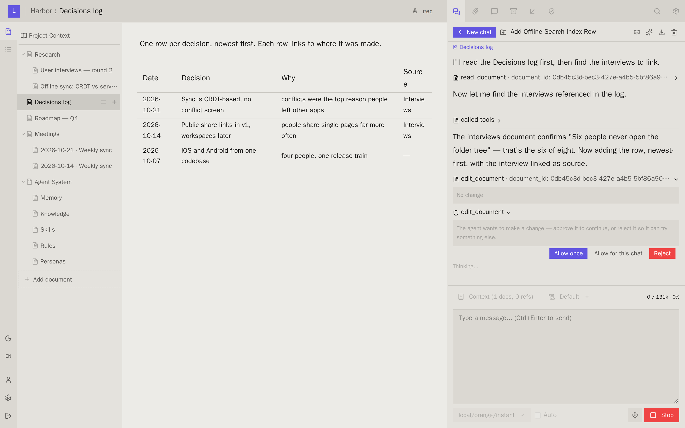
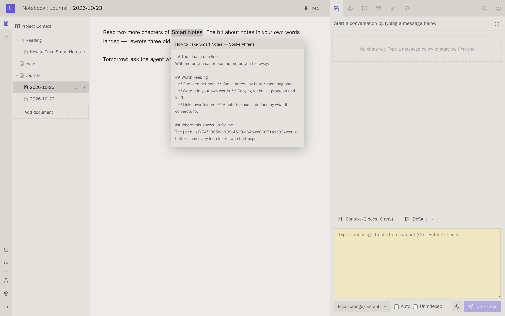
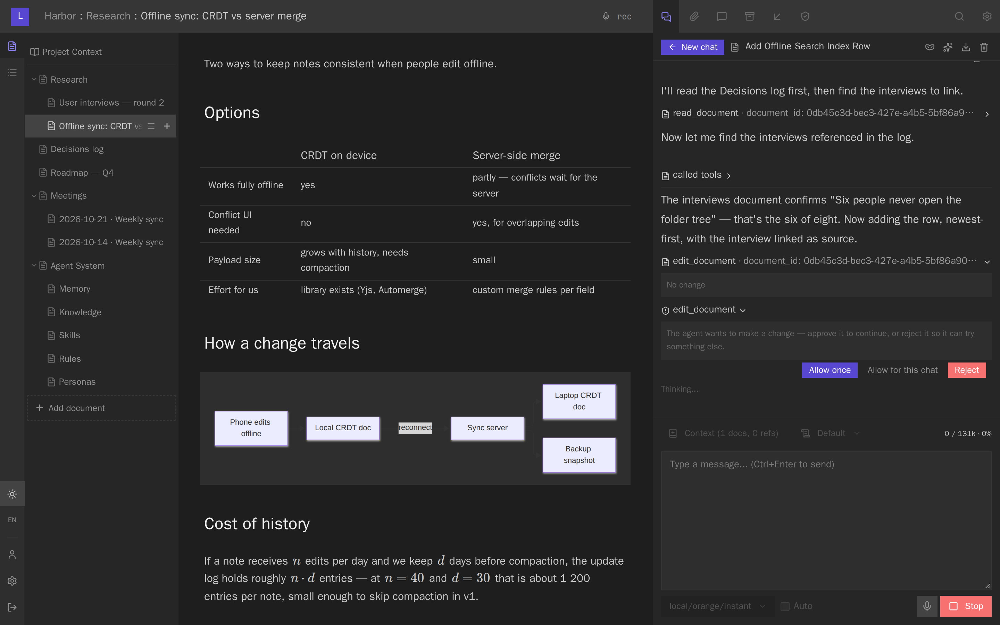
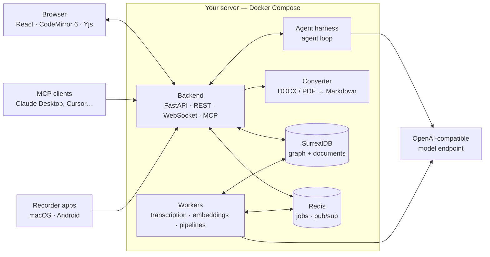

<div align="center">

# Lore

**A self-hosted second brain for small teams and enthusiasts — a linked graph of Markdown documents you edit together in real time, with an AI agent that sees the whole project and works inside it on your permissions.**

[](https://github.com/kreolsky/lore-knowledge-creator/tags)
[](#license)
[](https://github.com/kreolsky?tab=packages&repo_name=lore-knowledge-creator)
[](#install)

[Why Lore](#why-lore) · [Features](#features) · [Install](#install) · [Architecture](#architecture) · [Related projects](#related-projects) · [License](#license)

</div>



## Why Lore

Thinking happens in conversations, and conversations get lost. Notes apps keep the text but not the discussion that produced it; chat assistants keep the discussion but forget it between sessions and know nothing of your documents.

Lore keeps both in one project. Documents form a **graph** — linked, embedded, versioned. Chats live **next to the documents** they are about. The agent in the chat **sees the whole project**: it searches your documents, files and earlier conversations, so a thread you dropped last week can be picked up in a new chat without retelling it. A discussion turns into a document when it is ready, and the agent keeps a **project memory** — durable facts as small linked cards you can read and correct.

Capturing a thought takes one key: **voice input runs through the whole app** — dictate into a document or any chat, or leave a voice note that is transcribed and kept with the document it belongs to.

It works the same for one person and for a small team: write alone as a journal or a research notebook, or edit together in real time with comments and roles. When something is worth showing, **share it with a public link** — a single page or a whole section, readable without an account.

You run it yourself — on a server or on a laptop: the whole stack runs comfortably in Docker on an Apple M1. Your texts never leave it except to the model provider you configure, and that can be a model you host yourself.

## Features

### Write and connect

- **Live-preview Markdown editor** (CodeMirror 6): headings, tables, checklists, images, code, **KaTeX math** and **Mermaid diagrams** render in place while the source stays plain Markdown.
- **Documents in a tree**, ordered by hand, with drag-and-drop and keyboard navigation.
- **Links everywhere**: link documents, headings, notes and files; hover any link for a preview. Mentions are tracked as a graph, so every document knows what points at it.
- **Transclusion**: embed one document inside another; exports inline the embedded content.
- **Editable tables** as first-class blocks inside documents.
- **Export** any document to Markdown, DOCX or PDF.

### Think with an agent

The chat panel is a full agent loop, not a text box bolted onto an editor. It works on your documents with your permissions:

- **Sees the whole project**: semantic search over documents and files, the project outline, any document by link — and **your earlier chats**, so a new conversation can continue an old one. A chat can be excluded from that search when it should stay private.
- **Writes and edits**: creates documents, applies targeted edits, fills tables, moves and renames — with **approve / reject per change** when you want to stay in control.
- **Project memory**: the agent distills durable facts into small linked documents — one fact per card — that you read, link and correct like any other page.
- **Skills**: reusable instructions the agent loads on demand; the agent can write new ones for itself.
- **Personas**: switch the system prompt per chat session.
- **Web search**, **image generation** (ComfyUI) and an optional **sandboxed shell** for scripts and data work.
- Works with **any OpenAI-compatible endpoint** — hosted models or your own (vLLM, llama.cpp…). For everything else there is **[LLM API Gateway](https://github.com/kreolsky/llm-api-gateway)**, our router, bundled as an optional part of the stack: it puts Anthropic, other providers that speak their own API, and local servers behind one endpoint, with a separate key per app.

### Work together and share

- **Real-time co-editing** on CRDTs (Yjs): no locks, no merge conflicts, remote cursors in the gutter, safe reconnects after a network blip.
- **Comments anchored to text**, with threaded discussion right next to the passage.
- **Version history**: automatic checkpoints and snapshots; restore any earlier version.
- **Access control per project**: owner, full access, commentator, read-only; invite links for new members.
- **Public links** to a single document or a whole subtree — readable without an account, so a page you wrote can be sent to friends and colleagues as it is.

### Capture by voice and bring material in

- **Voice everywhere**: one shortcut (`Cmd+D`) dictates into the editor, any chat or a note; speech is transcribed by the model you configure.
- **Voice notes**: record a thought and it lands next to the document as a reference with its transcript — readable, searchable, and visible to the agent.
- **References**: attach images, PDFs, Word documents and audio to the project; each file carries its own text.
- **Automatic conversion**: DOCX and PDF become editable Markdown; audio is **transcribed**; images get thumbnails.
- **Recorder apps**: a macOS menu-bar recorder and an Android app send voice notes and recordings straight into a project for transcription.

### Connect other tools

- **MCP server**: connect Claude Desktop, Cursor or any MCP client to a project with a scoped key — external agents get the same tools, limited to the documents you allow.
- **Pipelines**: background jobs such as structured data extraction from transcripts, on demand or on a schedule.
- **REST API** with an OpenAPI schema (`openapi.json`).

### Yours to run

- **Self-hosted**: one Docker Compose file, no configuration needed to start; light enough for a laptop.
- Light and dark themes, English and Russian interface.

<table>
<tr>
<td width="50%"></td>
<td width="50%"></td>
</tr>
<tr>
<td align="center">A personal notebook — notes link to each other, hover to preview</td>
<td align="center">Tables, diagrams and math render in place; dark theme</td>
</tr>
</table>

## Install

Everything below is written to be followed literally — by a person or by an AI agent. Each step is a command followed by the check that proves it worked.

**Requirements:** Docker Engine **26.0 or newer** (`docker version`) with Docker Compose **v2.26.0 or newer** (`docker compose version`), and a free TCP port 5673.

### 1. Download and start

```sh
mkdir lore && cd lore
curl -fsSLO https://raw.githubusercontent.com/kreolsky/lore-knowledge-creator/main/docker-compose.yml
docker compose up -d
```

No configuration file is needed. The first start downloads the images and builds the AI agent and its sandbox from this repository, so the Docker host needs git and network access, and it takes several minutes.

### 2. Check that it runs

```sh
curl -s http://localhost:5673/api/health
```

Expected: a JSON object containing `"status":"ok"` and `"harness":"reachable"`. Until the backend has finished starting, the request fails or returns an error page — repeat it after 15 seconds.

### 3. Sign in

Open http://localhost:5673 and sign in:

| Email | Password |
|---|---|
| `admin@lore.app` | `lore-admin` |

**Change this password right away** (**Profile settings**). Anyone who can reach the port can try the default.

That is a complete install: the editor, collaboration, files and document conversion all work without AI. To turn on the AI features, see [Enable AI](#enable-ai) below — it takes only the admin panel.

To run it on a server behind your own domain with HTTPS, continue with [docs/self-hosting.md](docs/self-hosting.md): settings for a server, the reverse proxy, a password in front of Lore, updates and rollback.

### Settings

Settings go into a file named `.env` next to `docker-compose.yml`, one `NAME=value` per line. Apply them with `docker compose up -d`.

| Variable | Default | What it does |
|---|---|---|
| `LORE_PORT` | `5673` | Port the web interface listens on |
| `LORE_VERSION` | latest release | Pin a release, e.g. `v0.21.0` |
| `LORE_ADMIN_USERNAME` | `admin` | First admin, created once on the first start; the login is `<username>@lore.app` |
| `LORE_ADMIN_PASSWORD` | `lore-admin` | Password of that first admin; has no effect after the first start |

Every other setting is documented in [`.env.example`](.env.example).

### Enable AI

Lore talks to any **OpenAI-compatible API** (a hosted provider, or your own models behind LiteLLM, vLLM, llama.cpp…).

Recommended: [LLM API Gateway](https://github.com/kreolsky/llm-api-gateway) — a small self-hosted OpenAI-compatible gateway that puts cloud providers and local servers (llama.cpp, embeddings, speech-to-text) behind one endpoint, with a separate key per app. Give Lore its own key and point the AI API base URL at the gateway.

Sign in as admin, open **Admin panel → Models & APIs** and set:

- the **AI API base URL** and **key**;
- the **default chat model** — the agent's model;
- optionally the **session title model** (a non-reasoning model; empty = the chat model), and the speech-to-text and embedding model names for transcription and semantic search.

Every name must be a model your endpoint serves. No restart is needed: the agent uses the new settings from the next message. The agent and its sandbox — the isolated shell it runs scripts in — are already running; the secret between Lore and the agent and the sandbox key were generated on the first start. A value set in the admin panel wins over the same setting in `.env`.

### Troubleshooting

| Symptom | Check | Fix |
|---|---|---|
| `docker compose up` fails with `address already in use` or `port is already allocated` | another service uses 5673 | put `LORE_PORT=5674` (any free port) in `.env`, run `docker compose up -d`, use that port |
| `env_file` / `required` or `subpath is not allowed` error on `up` | `docker compose version` | upgrade Docker Compose to v2.26.0 or newer (and Docker Engine to 26.0 or newer) |
| after an update the backend log says `the database password file /secrets/surreal/pass is missing or empty` | `docker compose config --services` lists no `secrets-init` | the compose file predates v0.21.0: download it again and run `docker compose up -d --build` (see Update below) |
| health never returns `"status":"ok"` | `docker compose logs backend` | the log names the failing setting or service |
| the agent answers *harness service is not reachable*, or health shows `"harness":"unreachable"` | `docker compose logs harness` | the agent is still the previous build: run `docker compose up -d --build` (the agent is built from source, so an update without `--build` keeps the old one) |
| the agent answers *No chat model is set* or *No AI API URL is set* | **Admin panel → Models & APIs** | set the missing value; the next message uses it |
| chat sessions keep untitled-looking names | `docker compose logs harness` | if the log says the title model *advertises reasoning effort levels*, set **Session title model** in **Admin panel → Models & APIs** to a non-reasoning model your endpoint serves |
| forgot the admin password | — | put `LORE_ADMIN_USERNAME=admin2` and `LORE_ADMIN_PASSWORD=<new password>` in `.env`, run `docker compose up -d`; sign in as `admin2@lore.app` and set a new password for the old admin in **Admin panel** |
| behind a reverse proxy: a project does not open, the browser console shows `WebSocket … Unexpected response code: 404` | the proxy drops the WebSocket upgrade | [docs/self-hosting.md → The reverse proxy](docs/self-hosting.md#the-reverse-proxy) |

### Update

```sh
curl -O https://raw.githubusercontent.com/kreolsky/lore-knowledge-creator/main/docker-compose.yml
docker compose pull --ignore-buildable
docker compose up -d --build
```

All three lines are needed: the compose file itself changes between releases, and the agent and its sandbox are built from source — without `--build` they keep running the previous version. `--ignore-buildable` skips those locally built images in `pull`; without it `pull` reports *pull access denied* for `lore-harness`, `lore-sandbox` and `lore-sandbox-gw`, which is harmless.

### Data and backups

All data lives in Docker volumes named `lore_surreal` (database), `lore_storage` (uploaded files and the session key), `lore_secrets` (generated database password and agent secret) and `lore_redis`. `docker compose down` keeps them; `docker compose down -v` **deletes everything**. To back up, stop the stack and archive the volumes:

```sh
docker compose stop
docker run --rm -v lore_surreal:/surreal -v lore_storage:/storage -v "$PWD":/backup alpine \
  tar czf /backup/lore-backup.tar.gz /surreal /storage
docker compose start
```

## Architecture



- **Frontend**: TypeScript, React, Zustand, CodeMirror 6, Yjs, Tailwind, Vite.
- **Backend**: Python, FastAPI, Pydantic; background jobs on arq/Redis.
- **Database**: SurrealDB — documents, links and access rules live in one graph.
- **Agent**: the agent loop runs in a separate harness service built on [deepseek-harness](https://github.com/deepseek-ai/deepseek-harness) (vendored as `vendor/dsh`); Lore owns identity, permissions, storage and the tools.
- The backend is the only authority: every tool call — from the chat, the MCP server or a recorder app — passes the same permission check.

## Tuning search

Semantic search and the agent's retrieval depend on the embedding model and on two cut-offs set under **Admin → Settings → Search** — the score floor and the drop-off ratio. Both are calibrated per model: switch the model and re-derive them. [`scripts/search-tuning/`](scripts/search-tuning/) holds the measurement harness: it runs a fixed query set through the real retrieval, compares models by the rank of the right answer, and reads the cut-offs off the correct answers' scores.

## Related projects

Services Lore is built to run with — each is a separate, self-hosted repository with an OpenAI-compatible API, so Lore needs only a base URL and a key:

- **[LLM API Gateway](https://github.com/kreolsky/llm-api-gateway)** — one endpoint and one key in front of every model: cloud providers and local servers (llama.cpp, local embeddings, speech-to-text) side by side, with per-client access, pricing and usage. Point Lore's AI, embedding and transcription settings at it.
- **[STT API Server](https://github.com/kreolsky/stt-api-server)** — local speech recognition (Whisper, GigaAM) behind an OpenAI-compatible `/v1/audio/transcriptions`; transcribes Lore's audio references, voice input and recorder-app uploads.

## Contributing and security

Lore is developed in a private repository and published here as release snapshots: one commit per release. Issues — bug reports, questions, ideas — are welcome; pull requests are not accepted yet (see [CONTRIBUTING.md](CONTRIBUTING.md)). To report a vulnerability, see [SECURITY.md](SECURITY.md).

## License

Lore is **source-available** under the [Business Source License 1.1](LICENSE). It is not an OSI-approved open source license. Each version automatically converts to the **Apache License 2.0** four years after it is published.

### Free to use

You can use Lore in production for free, with no feature limits, if you and your affiliates (parent companies and subsidiaries) meet **all** of the following:

- less than **USD 1M gross revenue** in the last 12 months;
- less than **USD 1M total outside funding** raised;
- no more than **25 people** working for you, counting employees and contractors.

Individuals, non-profits, schools and universities, and any non-commercial use are always free, whatever their size. Evaluation, development and testing are free for everyone.

### Needs a commercial license

- Organizations above any of the thresholds above.
- **Anyone, of any size**, offering Lore to third parties as a hosted or managed service.

If your organization grows past a threshold, you have **90 days** to get a commercial license. Contact: zaigraeff@gmail.com.

### Examples

| Situation | License |
|---|---|
| A 6-person team, $300k revenue, self-funded | Free |
| One person running Lore on a laptop as a personal knowledge base | Free |
| A 12-person studio that got a $400k advance from a publisher | Free (a publisher advance counts as revenue, not funding) |
| A 10-person startup that raised a $3M seed round | Commercial |
| A studio owned by a large publisher, even if the studio is small | Commercial (affiliates count) |
| A company hosting Lore for its customers | Commercial |

Third-party components and their licenses are listed in [NOTICE](NOTICE). The document converter service in `converter/` is licensed separately under the [GNU AGPL v3.0](converter/LICENSE).
